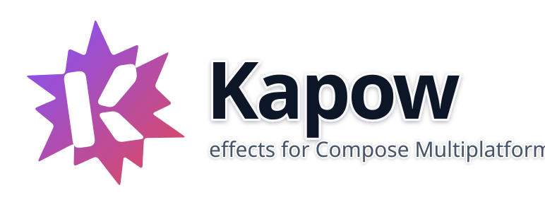
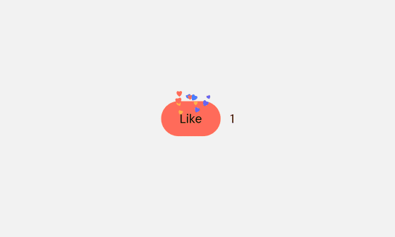
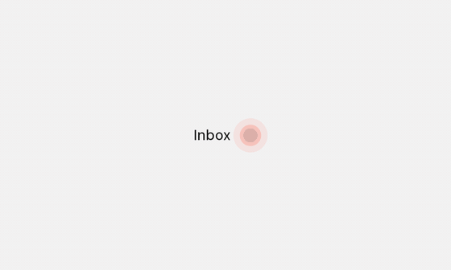
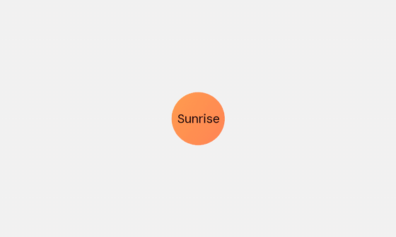

<p align="center">
  
</p>

# Kapow

[](https://central.sonatype.com/artifact/io.github.jantursky/kapow) [](https://github.com/jantursky/kapow/actions/workflows/ci.yml) [](https://kotlinlang.org) [](LICENSE) [](https://codecov.io/gh/jantursky/kapow)

[Docs](https://kapow-docs.vercel.app) · [Demo](https://kapow-demo.vercel.app) · [Maven Central](https://central.sonatype.com/artifact/io.github.jantursky/kapow) · [Changelog](CHANGELOG.md)

Effects for Compose Multiplatform that react to state: a burst of particles when a value changes, a halo while a condition holds, an iris or a puff of smoke when content appears or goes. Android, iOS, desktop and the browser, from one `commonMain`.

Compose already animates layout, alpha and transforms well, and libraries like animate-compose add shakes and bounces on top. What it lacks is the kind of effect [Pow](https://github.com/EmergeTools/Pow) brought to SwiftUI: one modifier that watches a value and plays something on the element when it changes. Kapow is that, written for Compose. It is an independent project, inspired by Pow and not affiliated with it.

### Change effects

<picture>
  <source media="(prefers-color-scheme: dark)" srcset=".github/assets/change-dark.gif">
  
</picture>

### Conditional effects

<picture>
  <source media="(prefers-color-scheme: dark)" srcset=".github/assets/conditional-dark.gif">
  
</picture>

### Transitions

<picture>
  <source media="(prefers-color-scheme: dark)" srcset=".github/assets/transitions-dark.gif">
  
</picture>

| folder              | what it is                                                                                          |
| ------------------- | --------------------------------------------------------------------------------------------------- |
| `kapow`             | The library, published to Maven Central as `io.github.jantursky:kapow`.                              |
| `kapow-crease`      | Optional: progress effects driven by the hinge angle of a foldable, through [Crease](https://github.com/jantursky/crease). |
| `kapow-multihaptic` | Optional: plays Kapow's feedback events as haptics through [multihaptic](https://github.com/xfqwdsj/multihaptic). |
| `samples/gallery`   | The gallery's examples and their controls, shared by the web, desktop and mobile gallery.            |
| `samples/web`       | The effect gallery: every effect live in the browser, with controls and its source.                  |
| `samples/desktop`   | The same gallery in a desktop window: `./gradlew :samples:desktop:run`.                              |
| `samples/androidApp`, `samples/iosApp` | The same gallery as Android and iOS apps (shared code in `samples/app`).          |
| `samples/design`    | Theme and widgets the gallery uses.                                                                  |
| `apps/docs`         | The docs site, built with [Blume](https://www.npmjs.com/package/blume).                              |

## Install

```kotlin
// build.gradle.kts
kotlin {
    sourceSets {
        commonMain.dependencies {
            implementation("io.github.jantursky:kapow:1.1.0")
            // Optional:
            implementation("io.github.jantursky:kapow-crease:1.1.0")
            implementation("io.github.jantursky:kapow-multihaptic:1.1.0")
        }
    }
}
```

Targets: Android (minSdk 23), iosArm64, iosSimulatorArm64, JVM desktop and wasmJs. The core depends only on Compose runtime, foundation, UI and animation, not on Material.

## Usage

```kotlin
import androidx.compose.animation.EnterTransition
import androidx.compose.foundation.layout.Box
import androidx.compose.foundation.shape.CircleShape
import androidx.compose.runtime.Composable
import androidx.compose.ui.Modifier
import com.jantursky.kapow.ChangeEffect
import com.jantursky.kapow.ConditionalEffect
import com.jantursky.kapow.KapowAnimatedVisibility
import com.jantursky.kapow.KapowEnter
import com.jantursky.kapow.KapowExit
import com.jantursky.kapow.KapowParticleLayer
import com.jantursky.kapow.ParticleContent
import com.jantursky.kapow.ParticleShape
import com.jantursky.kapow.changeEffect
import com.jantursky.kapow.conditionalEffect
import kotlin.time.Duration.Companion.seconds

@Composable
fun Post(likes: Int, hasUnread: Boolean, showToast: Boolean) {
    // Particles draw in this layer, so a clipping parent such as a list row doesn't cut them off.
    KapowParticleLayer {
        // Hearts spray up each time `likes` changes. The first composition plays nothing.
        Box(Modifier.changeEffect(likes, ChangeEffect.spray(ParticleContent.shape(ParticleShape.Heart))))

        // While there is something unread, a ring pulses out of the dot every two seconds.
        Box(
            Modifier.conditionalEffect(
                hasUnread,
                ConditionalEffect.repeat(ChangeEffect.pulse(CircleShape), every = 2.seconds),
            ),
        )

        // Grows in through a circle, leaves in a puff of smoke.
        KapowAnimatedVisibility(showToast, enter = KapowEnter.iris(), exit = KapowExit.poof()) {
            Box(Modifier)
        }
    }
}
```

There are three kinds of effect, each a plain modifier:

- `Modifier.changeEffect(value, effect)` plays once when `value` changes: `spray`, `rise`, `shine`, `pulse`, `glow`, `spin`, `ripple`, `flash`, `burst`, `speedLines`, `sparkle`, `fireworks`, `confettiPop`, `hearts`, `trace`, `strike`, `stamp` and `glitch`, with `.delay(…)`, `.cooldown(…)`, `.times(…)`, `.speed(…)` and `.reducedMotion(…)` on any of them.
- `Modifier.conditionalEffect(condition, effect)` runs while `condition` is true: `glow`, `pushDown`, `smoke`, `borderBeam`, `marchingAnts`, `rainbowBorder`, `sparkles`, `orbit`, `bubbles`, `flame`, `grayscale`, `spotlight`, `shimmer`, `breathe`, `ping`, `confettiRain`, and `repeat(changeEffect, every)`, with `.fadeIn(…)`, `.fadeOut(…)`, `.startDelay(…)`, `.speed(…)` and `.reducedMotion(…)` on any of them.
- `Modifier.progressEffect(effect) { progress }` draws `shine`, `glow`, `iris`, `fill` or `trace` at a progress you supply, such as a scroll offset, with `.curve(…)` and `.smoothed()` to shape it. `kapow-crease` uses it for `Modifier.hingeEffect(effect)`.

Transitions are `KapowEnter` and `KapowExit` values: `iris`, `clock`, `wipe`, `glare`, `blinds`, `dissolve`, `curtain`, `shapeIris`, `checker`, `tear` and `blob` both ways, `anvil` and `pop` to enter, and `poof`, `shatter` and `disintegrate` to exit. Every transition also takes `.delay(…)`, `.easing(…)` and `.reducedMotion(…)`, and `KapowStagger.delay(index)` cascades the items of a list. Use `KapowAnimatedVisibility`, or `Modifier.kapowTransition(this, enter, exit)` inside `AnimatedVisibility` or `AnimatedContent`. Change effects and transitions take an optional `KapowFeedbackEvent` for haptics or sound; see the [feedback guide](https://kapow-docs.vercel.app/guides/feedback).

Beyond effects on a modifier there are a few more pieces: `Modifier.kapowSkeleton(loading)` covers content with a shimmering placeholder and reveals it when loading ends, `KapowTypewriter` types or unscrambles text, `KapowCounter` rolls or counts a number to its new value, and `Modifier.kapowTilt()` tilts an element in 3D toward the pointer. Every effect has many more options than the defaults show; particle effects take a `ParticlePhysics` for direction, speed, gravity, lifetime and more. The [effect pages](https://kapow-docs.vercel.app/effects) list them all.

## Demo

The [gallery](https://kapow-demo.vercel.app) runs every effect in the browser, compiled to Kotlin/Wasm. Each page sets the effect in a small app scene, lets you change its parameters and shows the code next to it. A meter in the bar shows the frame time while effects play, and a switch shows what each effect does with reduced motion.

## How it works

1. Each effect modifier is a `ModifierNodeElement`, not a composable (`kapow/src/commonMain/.../EffectModifiers.kt`). When the watched value changes, `update()` tells the node, which starts the effect in its own coroutine scope. No `remember`, no `LaunchedEffect`.
2. Animation state lives in the node as snapshot state (`Animatable`s and frame counters) and is read only while drawing or in the graphics layer block (`internal/EffectNode.kt`). A frame invalidates drawing, not composition. Tests count recompositions for every effect.
3. Effects that need the element's own pixels, such as the shine band or a mask, draw it into an offscreen layer and blend on top with `SrcAtop` or cut with `DstOut` (`effects/Shine.kt`, `transitions/Masks.kt`). That works the same on every target and on Android 6, with no shaders.
4. Particles are small struct-of-arrays systems stepped by the frame clock and capped at 1/30 s per step (`particles/`). An effect hands its batch to the nearest `KapowParticleLayer` with its position in the layer's coordinates, or draws it itself when there is none.
5. Transitions animate a progress value on the `AnimatedVisibilityScope`'s own transition (`Transitions.kt`). That is why `AnimatedVisibility` and `AnimatedContent` keep the content until an exit has finished, even though Compose's `EnterTransition` and `ExitTransition` can't be extended.
6. Reduced motion is read from the platform: the animator duration scale on Android, Reduce Motion on iOS, `prefers-reduced-motion` in the browser (`platform/ReducedMotion.kt`). `LocalKapowMotion` overrides it. Moving effects then become a short brighten or fade.

## Prior art

- [Pow](https://github.com/EmergeTools/Pow) (SwiftUI, MIT): the model for Kapow's change effects, conditional effects and transitions. Some timings, springs and geometry are derived from it and credited in [NOTICE](NOTICE). Kapow doesn't aim to look exactly like Pow.
- [animate-compose](https://github.com/nomanr/animate-compose) (Kotlin Multiplatform): more than 90 animate.css-style presets such as bounce, shake, flip and slide. Kapow leaves these transform-only animations to it.
- [Composed](https://github.com/w2sv/Composed) (Compose Multiplatform): a shake controller and a staggered grid entrance. [shaker](https://github.com/taewooyo/shaker) is a spring shake for Android only.
- [ConfettiKit](https://github.com/vinceglb/ConfettiKit) (Kotlin Multiplatform port of Konfetti) and [ParticleEmitter](https://github.com/PiotrPrus/ParticleEmitter): confetti and a general particle engine. Kapow's particles are a few presets tied to an element, not an engine. [ExplodingComposable](https://github.com/omkar-tenkale/ExplodingComposable) explodes a composable into dust, Android only.
- [compose-shimmer](https://github.com/valentinilk/compose-shimmer): a looping placeholder shimmer. Kapow's `shine` plays once on a change.
- [compose-theme-reveal](https://github.com/mofeejegi/compose-theme-reveal): iris, shutter and similar reveals for theme switches. Kapow's masks work on any content you show or hide.

A search of the web and GitHub in October 2026 found no port of Pow to Compose. The [prior art page](https://kapow-docs.vercel.app/prior-art) has more detail.

## Not covered yet

- No shaders. Compose Multiplatform has no common shader API, and every effect here works without one. Glow uses a blurred layer where blur exists and stacked outlines on Android before 12.
- No sprite or image-sequence effects. Smoke, dust and the poof are drawn procedurally, so they don't look like Pow's sprites.
- Glow follows the element's `Shape`, not the alpha of its content.
- In-flight particles don't follow content that scrolls after they were emitted.
- `kapow-multihaptic` maps events to multihaptic's predefined primitives. Custom events are left to your own `KapowFeedback`.

## Platform support

| platform | effects | blurred glow | reduced motion from | checked on |
| --- | --- | --- | --- | --- |
| Android 6+ (API 23) | all | Android 12+, stacked outlines before | animator duration scale | Robolectric; not yet on a device |
| iOS | all | yes | Reduce Motion | simulator tests; not yet on a device |
| JVM desktop | all | yes | none, use `LocalKapowMotion` | tests and screenshots |
| wasmJs | all | yes | `prefers-reduced-motion` | Chromium via Playwright; not yet Firefox or Safari |

Built with Kotlin 2.4 and Compose Multiplatform 1.12.

## Development

Needs JDK 17+, the Android SDK, Xcode for the iOS simulator, and [Bun](https://bun.sh) 1.3+ with Node 22.19+ for the docs, the browser tests and the screenshots.

```sh
./gradlew :kapow:check :kapow:koverVerify     # tests on JVM, Android (Robolectric), iOS simulator and wasm, plus coverage
./gradlew :kapow:verifyRoborazziJvm           # screenshot tests of key frames
./scripts/pack-test.sh                        # publish to Maven Local and compile a consumer against it
bun install && bun run dev:docs               # docs site

./gradlew :samples:desktop:run                # the effect gallery in a desktop window
./gradlew :samples:androidApp:installDebug    # the gallery as an Android app; samples/iosApp for iOS (xcodegen)
scripts/device-smoke.sh android|ios           # open every gallery page on an emulator or simulator, report crashes
./gradlew :samples:web:wasmJsBrowserDistribution
bun run test:web                              # browser tests of the gallery (Playwright, axe), desktop and phone
bun run screenshots                           # rebuild the gallery and refresh the README GIFs
```

CI runs on every push and pull request: formatting, the binary API check, the tests on every target with the coverage gate (uploaded to Codecov), the browser tests of the gallery, a consumer build against Maven Local and the docs build. See [CONTRIBUTING.md](CONTRIBUTING.md).

## License

[MIT](LICENSE) © Jan Tursky. Pow's license and copyright notice are in [NOTICE](NOTICE).
